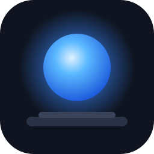
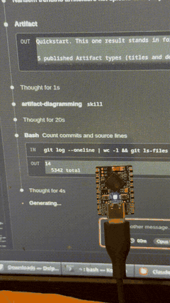

<p align="center"></p>

<h1 align="center">CodeShelf Light</h1>

<p align="center">A desk light that shows what your AI coding agents are doing.<br>
Blue while they work, green when they wait for you, amber when they need an answer, red when they fail.</p>

<p align="center"></p>

---

You start an agent, switch to something else, and come back too early or far too late.
CodeShelf Light is a small RGB light next to your screen that tells you when to look.
It works with Claude Code, Gemini CLI, GitHub Copilot CLI, Cursor and any tool that can run a command on an event.

- **One glance:** working, waiting, needs you, error. Several sessions at once show the most important one.
- **Your colors:** pick a color, pattern (solid, breathe, blink, double blink, flash, rainbow) and speed for each state, from your phone.
- **Answer from your phone:** optionally, permission requests and questions from Claude Code show on the light's page, and you can chat with it from there. Both are off by default; see the [extension](extension/README.md).
- **Several lights:** one per project, one per agent, or one on every desk.
- **No cloud:** the light lives on your WiFi (or a USB cable). Nothing leaves your network.
- **Cheap hardware:** an ESP32-S3 board with a built-in RGB LED, about €5.

## What is in this repository

| Folder | What it is |
|---|---|
| [`firmware/`](firmware) | ESP32-S3 firmware (PlatformIO): LED patterns, settings page, HTTP, Bluetooth LE and USB |
| [`extension/`](extension) | VS Code extension: installs the agent hooks and drives your lights |
| [`setup/`](setup) | CodeShelf Light Setup: desktop app for Windows, macOS and Linux that installs the firmware and sets up WiFi over USB |
| [`docs/`](docs) | Hardware, protocol, firmware and troubleshooting guides |

## Quick start

### 1. Get the hardware

A [Waveshare ESP32-S3-Zero](https://www.waveshare.com/esp32-s3-zero.htm) (it has a WS2812 RGB LED on board) and a USB-C data cable.
If you want to support the development, buy the board through this [affiliate link](https://link.amazon/B04Dw83Y8) (I get a small commission and you pay the same). It helps cover the costs.
Any ESP32-S3 board with a WS2812 LED works with a one-line change; see [hardware](docs/hardware.md).

### 2. Set up the light

Download **CodeShelf Light Setup** for your system from the [latest release](https://github.com/dumr666/CodeShelfLight/releases/latest):

| System | File |
|---|---|
| Windows | [`codeshelf-setup-windows.exe`](https://github.com/dumr666/CodeShelfLight/releases/latest/download/codeshelf-setup-windows.exe) |
| macOS | [`codeshelf-setup-macos.zip`](https://github.com/dumr666/CodeShelfLight/releases/latest/download/codeshelf-setup-macos.zip) (unzip, then right-click → Open the first time) |
| Linux | [`codeshelf-setup-linux`](https://github.com/dumr666/CodeShelfLight/releases/latest/download/codeshelf-setup-linux) (`chmod +x`, and see [serial port access](docs/troubleshooting.md#linux-permission-denied-on-the-serial-port)) |

Plug in the board, open the app and:

1. **Install firmware**. Takes about 30 seconds.
2. Pick your **WiFi network**, enter the password and choose a **name**, then **Save to light**.
3. The app shows the light's address, e.g. `http://codeshelf-light-1a2b.local/`.

Prefer your phone? A light without WiFi can also be set up over Bluetooth from the [web app](docs/firmware.md#bluetooth-app).

### 3. Install the VS Code extension

Download `codeshelf-light-<version>.vsix` from the [latest release](https://github.com/dumr666/CodeShelfLight/releases/latest) and install it:

```bash
code --install-extension codeshelf-light-1.0.0.vsix
```

On first start it finds the light on your network, adds it, and asks to add hooks for Claude Code.
Pick more agents with **CodeShelf Light: Choose Agents**. That is all; start an agent and watch the light.

The [extension README](extension/README.md) covers several lights, per-project lights, muting sessions and your own agents.

## How it works

```
 Claude Code ─┐
 Gemini CLI  ─┤ hooks   ~/.codeshelf/light/   VS Code     WiFi (HTTP)
 Copilot CLI ─┼───────▶  sessions/*.json ───▶ extension ─────────────▶ CodeShelf Light(s)
 Cursor      ─┤                                          or USB serial
 your tool   ─┘
```

1. Each agent runs a tiny hook script on its events (prompt submitted, tool used, permission asked, stopped …).
   The script maps the event to a state and writes one small file per session.
2. The extension watches those files, works out the most important state for each light, and sends it as one letter (`T`, `G`, `Y`, `R`, `O`).
3. The light fades to that state's color and pattern. If it hears nothing for 30 seconds (computer asleep, VS Code closed), it turns off.

The light has its own settings page at `http://<name>.local/`. It is styled like iOS settings and works well on a phone.
Add it to your home screen for an app icon.

## Documentation

- [Hardware](docs/hardware.md): parts, other boards, LED strips, a diffuser
- [Firmware](docs/firmware.md): building, flashing, OTA updates, the settings page, the Bluetooth app
- [Protocol](docs/protocol.md): HTTP API, USB serial protocol, Bluetooth LE, mDNS. Drive the light from anything.
- [Troubleshooting](docs/troubleshooting.md)
- [Extension](extension/README.md) · [Setup app](setup/README.md)

## Building from source

```bash
# Firmware (needs PlatformIO)
cd firmware && pio run -t upload

# Extension
cd extension && npm test && npm run package

# Setup app (needs Python 3.10+)
cd setup && pip install -r requirements.txt && python codeshelf-setup.py
```

[CONTRIBUTING.md](CONTRIBUTING.md) has the details, tests and the release process.

## License

[MIT](LICENSE). The setup app's standalone builds bundle [esptool](https://github.com/espressif/esptool), which is GPL-2.0-or-later, so those binaries are distributed under the GPL; the source in this repository stays MIT.
